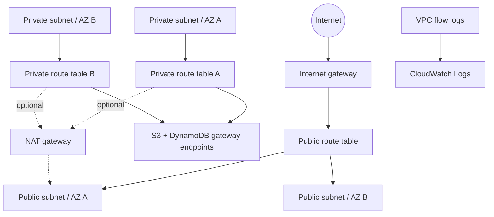

# Terraform AWS Infrastructure

A security-oriented, cost-aware AWS network foundation built as a learning portfolio
project. Everything can be formatted, linted, tested, validated, and scanned locally
without AWS credentials.

> The repository does not run `terraform apply`, create cloud resources, or require a
> real AWS account. Deployment is intentionally left for a future controlled environment.

## What this project demonstrates

- Reusable Terraform modules with typed, validated inputs
- A VPC spanning two or more availability zones
- Separate public and private subnet tiers
- No automatic public IPv4 assignment on any subnet
- Default security-group rules removed
- VPC flow logs enabled by default with finite retention
- S3 and DynamoDB gateway endpoints for private subnets
- An optional NAT gateway that is disabled by default
- Native Terraform tests with a mock AWS provider
- Reproducible provider selection through `.terraform.lock.hcl`
- CI formatting, validation, linting, IaC scanning, and secret detection

## Architecture



The public tier has a route to the internet gateway, but instances do not receive public
addresses automatically. The private tier has no default internet route unless the
billable NAT gateway is explicitly enabled. See [the architecture notes](docs/architecture.md).

## Local validation

Prerequisites:

- Docker Engine or Docker Desktop
- GNU Make

Run the complete credential-free validation suite:

```bash
make check
```

This executes:

1. `terraform fmt -check`
2. `terraform init -backend=false`
3. `terraform validate`
4. Native Terraform tests with a mock provider
5. TFLint recommended rules
6. Trivy HIGH/CRITICAL IaC policy checks

The same controls run on every push and pull request. Gitleaks additionally scans the
complete Git history in CI.

## Configuration

Copy the example only when experimenting locally:

```bash
cp terraform.tfvars.example terraform.tfvars
```

`terraform.tfvars` is ignored. Do not put credentials or sensitive values in Terraform
variables; use short-lived workload identity or AWS IAM Identity Center in a real
environment.

| Input | Default | Purpose |
| --- | --- | --- |
| `project_name` | `platform-lab` | Naming and tagging prefix |
| `environment` | `dev` | Environment tag and name component |
| `aws_region` | `eu-central-1` | Target AWS region |
| `availability_zones` | region zones `a` and `b` | Explicit zone override |
| `vpc_cidr` | `10.40.0.0/16` | Private address space |
| `enable_nat_gateway` | `false` | Opt in to billable private egress |
| `enable_flow_logs` | `true` | Capture VPC traffic metadata |
| `flow_log_retention_days` | `30` | CloudWatch retention period |

## Cost and deployment guardrails

- NAT is disabled by default because it incurs hourly and data-processing charges.
- Flow logs are enabled for security visibility and can generate ingestion and storage
  charges if deployed.
- CI never runs `plan` against an account and never runs `apply`.
- No backend bucket, account ID, role ARN, key, password, or username is committed.
- Always review the current AWS pricing pages and a saved plan before deployment.

Read [the operating guide](docs/operations.md) before connecting an AWS environment.

## Repository layout

```text
.
├── .github/workflows/ci.yml  # Read-only CI quality and security gates
├── docs/                     # Architecture, operations, and validation evidence
├── modules/network/          # Reusable AWS network module
├── tests/                    # Native tests using a mock AWS provider
├── Makefile                  # Containerized local workflow
├── terraform.tfvars.example # Non-sensitive example values
└── *.tf                      # Root module and validated inputs/outputs
```

## Security

Read [SECURITY.md](SECURITY.md) for the trust model and secret-handling rules. The latest
local test evidence is in [docs/validation.md](docs/validation.md).

## Next milestones

- Bootstrap an encrypted remote-state backend in a separate repository
- Add an OIDC-only deployment workflow with protected environments
- Add budget alerts and policy-as-code checks for resource cost classes
- Extend the network module with optional IPv6 egress controls
